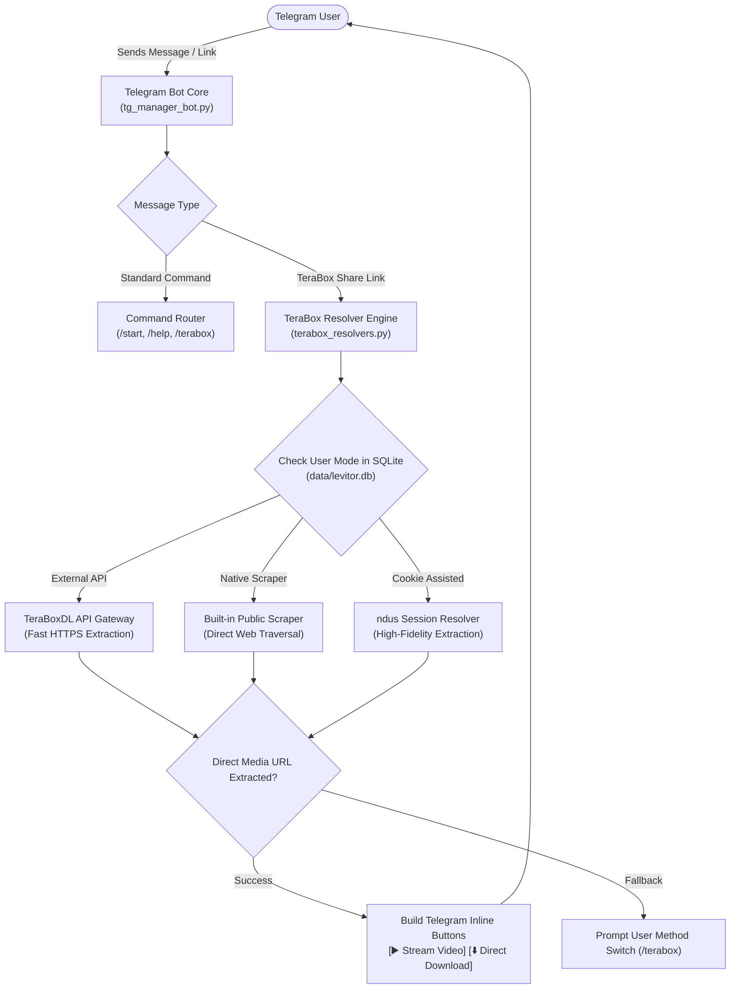

# LevitorBot — Telegram Content & Media Automation Bot

[](https://www.python.org/)
[](https://python-telegram-bot.org/)
[](https://github.com/LonamiWebs/Telethon)
[](https://www.sqlite.org/)
[]()
[](.github/workflows/python-tests.yml)

An asynchronous Telegram automation and media management bot built using **python-telegram-bot**, **Telethon**, and **SQLite**. It features high-speed media resolution, multi-tier TeraBox link extraction with direct download/stream generation, channel administration workflows, and persistent user configuration.

---

## 🏛️ System & Link Resolution Architecture



---

## ⚡ Core Features

1. **Multi-Provider Link Extraction:**
   * **Hosted API Gateway (`TeraBoxDL`)**: High-speed cloud-based extraction using API tokens.
   * **Native Scraper**: In-house DOM and metadata parser for public share links.
   * **Cookie-Assisted Scraper**: Advanced session-cookie (`ndus`) resolver for protected files.
2. **User Preference Customization:**
   * Telegram users select their preferred resolver route via the `/terabox` command, securely remembered across sessions in SQLite.
3. **Streamlined Inline UI:**
   * Delivers direct streaming playback buttons and high-speed browser download links straight inside the chat.
4. **Dual Engine (Bot API + Userbot Client):**
   * Combines official `python-telegram-bot` event handling with `Telethon` for extended media indexing and message routing.

---

## 🧪 Automated Test Suite (20 Tests)

All URL parsers, resolver fallback chains, response normalization routines, and database operations are covered by Pytest:

```bash
python -m pytest tests/
```

```text
============================= test session starts =============================
platform win32 -- Python 3.14.7, pytest-9.1.1
collected 20 items

tests/test_terabox.py ........                                           [ 40%]
tests/test_terabox_resolvers.py ............                             [100%]

============================= 20 passed in 0.32s ==============================
```

---

## 🚀 Setup & Deployment

### Prerequisites
* **Python**: 3.10 or newer
* Telegram Bot API Token from [@BotFather](https://t.me/BotFather)
* Telegram API ID & Hash from [my.telegram.org](https://my.telegram.org) (for Telethon userbot features)

### 1. Install Dependencies
```bash
git clone https://github.com/shutkarshX/LevitorBot.git
cd LevitorBot
pip install -r requirements.txt
```

### 2. Environment Configuration
Create a `.env` file in the root directory:

```dotenv
BOT_TOKEN=your_telegram_bot_token
API_ID=your_telegram_api_id
API_HASH=your_telegram_api_hash

# TeraBox Resolver Keys (Optional)
TERABOX_API_KEY=your_teraboxdl_api_key
TERABOX_EXTERNAL_RESOLVER_URL=
TERABOX_NDUS_COOKIE=
```

### 3. Run the Bot
```bash
python tg_manager_bot.py
```

---

## 📂 Repository Structure

```text
LevitorBot/
├── tg_manager_bot.py          # Primary asynchronous Telegram bot application
├── terabox.py                 # Core link extraction and button generator
├── terabox_resolvers.py       # Multi-provider resolution handlers
├── tests/                     # 20 automated Pytest test cases
│   ├── test_terabox.py
│   └── test_terabox_resolvers.py
├── scripts/                   # Database migration & backup utilities
├── data/                      # Persistent SQLite storage (levitor.db)
├── docs/                      # Technical resolver documentation
├── .github/workflows/         # CI/CD automated test pipeline
├── requirements.txt
└── README.md
```
